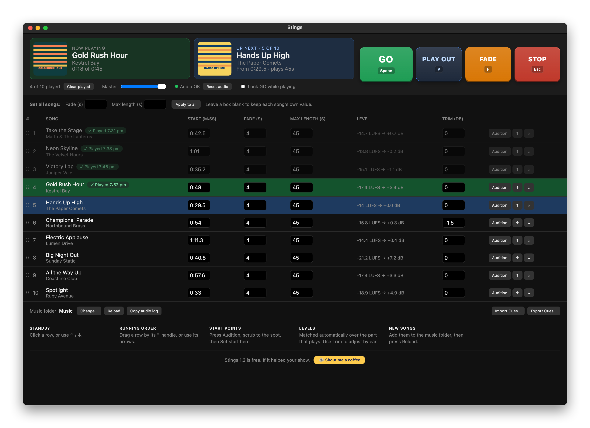
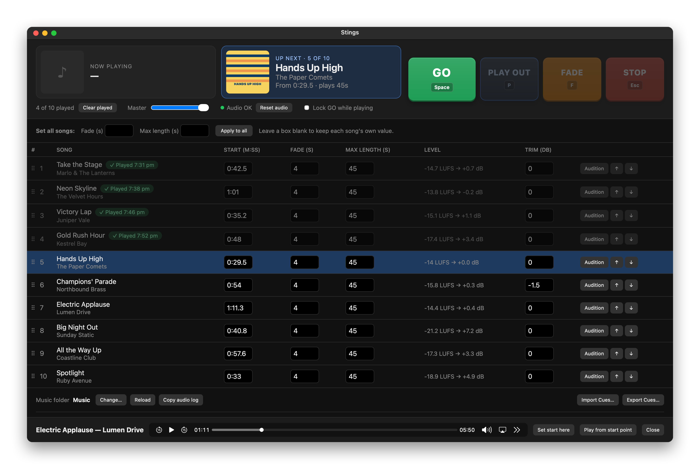
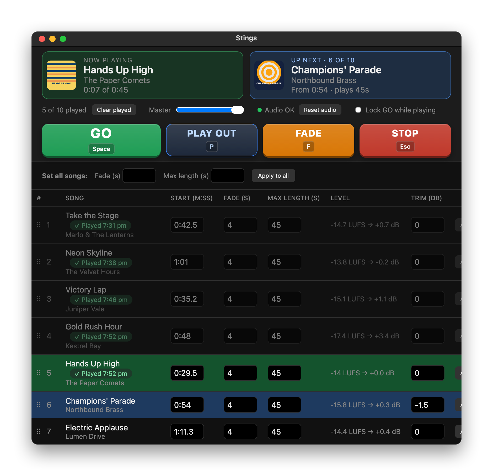

# Stings

A cue player for awards nights and live events. Line up short music "stings", press **GO** as each winner walks up, and fade out when they're done.

**[⬇ Download Stings for Mac](https://github.com/remi-sustainablechoice/stings/releases/latest/download/Stings.zip)** · macOS 13 Ventura or later · Apple Silicon and Intel

## Features

- **GO / FADE / STOP** from the keyboard (Space, F, Esc), with the next song always on standby
- **Start points**: begin each song at the chorus, not the intro
- **Even levels**: songs are loudness-matched automatically, with a trim to adjust by ear
- **Max length and fade time** per song, or set them all at once
- **Play out**: let a song run to the end when the moment needs it
- **Played labels** so you can see what's been used, and clear them after a rehearsal
- **Drag to reorder** the running order
- **Import / export cues** to move a show between Macs
- **Audio recovery**: if the Mac's audio output drops out (an HDMI or Bluetooth change, sleep), Stings restarts it and the song carries on

## Getting started

1. Download **Stings.zip**, open it, and drag **Stings** into your Applications folder.
2. Open Stings and choose a folder of music (MP3, M4A, AAC, WAV, AIFF or FLAC).
3. Audition each song, set its start point, and you're ready.

Your settings are saved in a file called `Stings Show.json` inside the music folder, so copying the folder to another Mac copies the whole show.

On a laptop screen the controls stack above the running order, so nothing overlaps:

*Songs and artists in the screenshots are made up.*

Stings doesn't include music. Use tracks you have the rights to play at your event.

## Updates

Stings checks for new versions when it opens and shows an **update available** button if there is one. You can also choose **Stings › Check for Updates…**. To update, download the new version and replace the old app. Your shows are kept.

## Support Stings

Stings is free. If it helped your show, you can [shout me a coffee ☕](https://www.paypal.com/donate/?business=LDYEJJTYTNH5W&no_recurring=0&item_name=Shout+me+a+coffee+if+you+find+Stings+useful+&currency_code=AUD).
